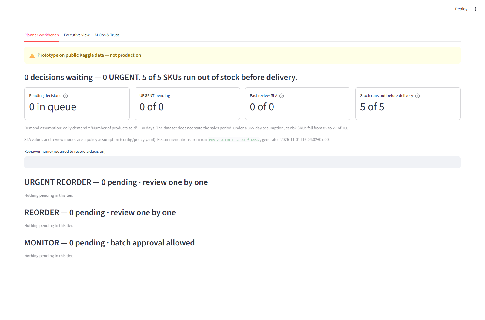

# Supply Chain Intelligence Agent

*Multi-agent AI system for supply chain risk detection, supplier optimisation, and portfolio-level decision support.*

Under a 30-day demand assumption, **85 of 100 SKUs** in a public beauty and personal-care supply chain dataset are flagged at risk of stockout (27 under a 365-day assumption). This project demonstrates how agentic AI can support supply chain decision-making — identifying stockout risks, optimising supplier selection under real-world constraints (lead time, quality, cost), and surfacing portfolio-level risks such as supplier concentration.

*Built on a public Kaggle supply chain dataset ([Supply Chain Analysis](https://www.kaggle.com/datasets/harshsingh2209/supply-chain-analysis)).*

---

## Real Output Example

```
SKU68 | haircare | stock = 0 units | daily demand = 5.43 units/day

Action            : URGENT_REORDER
Recommended       : Supplier 4  (lead time 14.5d — fastest available)
Order quantity    : 119 units   [calc: ceil(5.43 × 14.5d × 1.5)]
Reason            : No stock remaining; Supplier 4 selected under URGENT weights
                    (lead time 70%) — delivers 7 days faster than Supplier 3.
Rejected suppliers: Supplier 5, Supplier 3, Supplier 2, Supplier 1
```

> Without urgency-aware weighting, this approach would have chosen Supplier 3 (best defect rate, but slowest lead time at 21.4 days). SKU68 has zero stock — speed wins.

Agent 4 then synthesises all 5 decisions as a portfolio (BLUF format — executive summary first).

Output from run `run-20261101T160334-f16456`:

```
  ### 1. Executive Summary
  The analysis reveals significant risk concentrations within our SKU portfolio, particularly in haircare products, which dominate high-urgency reorders. Furthermore, Supplier 3’s role across multiple SKUs heightens our exposure risk, necessitating immediate evaluation of supplier reliability and inventory strategies.

  ### 2. Critical Warnings
  ! Supplier 3 provides for multiple high-risk SKUs (SKU2, SKU24) — if Supplier 3 fails, 233 units are at risk
  ! Supplier 1 is suggested for monitoring two SKUs (SKU16, SKU34) — a concentration of risk on decision-making regarding supplier performance

  ### 3. Key Insights
  - 3 of 5 SKUs are haircare — category is over-represented in the at-risk portfolio
  - 2 of 5 SKUs depend on Supplier 3 — potential impact from supplier failure affects 233 units
  - 2 of 5 SKUs depend on Supplier 1 for monitoring — vulnerability in maintaining supplier reliability
```

Every count, SKU, supplier, unit total and inspection claim in this output is fact-checked by a guardrail against Agent 3's decisions before it is accepted (see *Known limitations*).

---

## What the prototype demonstrates

- Flags SKUs whose remaining stock will not cover supplier lead time, ranked by revenue density
- Ranks suppliers across competing constraints — lead time, defect rate, and manufacturing cost — with weights that change by urgency
- Surfaces supplier concentration that is not visible when SKUs are evaluated one at a time
- Chains four agents with deterministic tools and code guardrails around each LLM step

## Persona views

`streamlit run app.py` opens three tabs over the same real data (dataset, last pipeline run, and the logs in `logs/`). No view calls an LLM, and none shows seeded or simulated numbers: a metric that cannot be computed is shown as *Not measured in prototype*.

| View | For | Question it answers |
|---|---|---|
| **Planner workbench** | Planner / procurement | *What must I decide today?* — queue ordered URGENT → REORDER → MONITOR, timing (days of cover vs. supplier lead time), evidence, SLA, and Approve / Edit / Reject with a required next step |
| **Executive view** | Leadership / steering | *Is the AI helping the business?* — portfolio KPIs with context, Agent 4's fact-checked summary and concentration risks |
| **AI Ops & Trust** | AI / IT / risk | *Should agents get more or less autonomy?* — LLM token cost per decision, guardrail retries, override and edit rates, audit trail, autonomy policy |

The Executive headline and top-supplier tile use orders needing action now (URGENT_REORDER + REORDER); the all-orders share (incl. MONITOR) is shown as secondary text.

Screenshots: [docs/screenshots/](docs/screenshots/). Reviewer actions are appended to `logs/decisions_log.jsonl`; each pipeline run to `logs/run_log.jsonl`. Setup and commands: [RUN_LOCAL.md](RUN_LOCAL.md).



## Known limitations

- **Public sample data, not production.** Runs on a 100-SKU public Kaggle dataset; it has not been tested against real ERP or live inventory data.
- **LLM synthesis is guarded, not guaranteed.** Agent 4 is pure LLM reasoning. Its counts, SKU codes, supplier claims, unit totals and inspection claims are fact-checked against Agent 3's decisions by `portfolio_output_guardrail`, and CrewAI retries on failure — but qualitative wording (e.g. "significant", "dominates") is not checked.
- **Thresholds are assumptions.** Risk scoring is anchored to AQL 2.5 and a 14-day replenishment cycle assumption; neither has been calibrated to a specific business.
- **No tracing enabled yet.** `logs/run_log.jsonl` records per-task duration, guardrail pass/fail and token usage, but individual prompts and responses are not traced.
- **Urgency ignores days of cover.** Urgency is derived from supplier risk + zero stock only; it does not yet escalate SKUs whose days of cover are below lead time (e.g. SKU16/SKU34 are MONITOR with less than 1 day of cover — 0.21 and 0.05 days). Planned fix, not implemented.
- **Demand period is assumed.** `daily_demand` assumes "Number of products sold" covers 30 days; the dataset does not state the period. Under a 365-day assumption, at-risk SKUs fall from 85 to 27 of 100.
- **Lead times are supplier averages.** Supplier comparison and timing use each supplier's average lead time within the product category, not SKU-specific lead times.
- **Order quantity is a heuristic.** Order quantity is a simple heuristic, ceil(daily demand × lead time × 1.5): no MOQ, demand variability or supplier capacity.
- **Supplier switches are not qualified.** Supplier switches assume any supplier in the category can supply the SKU (no qualification, approved-vendor or contract check).
- **Review policy is assumed.** Reviewer actions, SLA values and the autonomy rule in `config/policy.yaml` are prototype policy assumptions. Cost per run is an estimate from dated price constants in `config/pricing.yaml`.

---

## Decision Flow — Multi-Agent Orchestration

**Agent 1 — Supply Chain Data Analyst**
Analyses the full dataset (100 SKUs) to identify products at risk of running out before the next replenishment arrives. Calculates days of stock remaining versus supplier lead time, then ranks the top 5 urgent SKUs by revenue density — prioritising highest-value stockouts first.
*Output: ranked list of at-risk SKUs with stock levels, days remaining, and revenue.*

**Agent 2 — Supply Chain Risk Analyst**
Scores each at-risk SKU for supplier and quality risk using three signals — lead time, defect rate, and inspection results — assigning a risk level of Critical, High, or Medium anchored to AQL 2.5 (defects) and a 14-day cycle assumption (lead time).
*Output: structured risk report with score, flags, and classification per SKU.*

**Agent 3 — Procurement Recommendation Agent**
For each SKU in the risk report, calls the Supplier Comparison Tool with urgency context. The tool selects scoring weights based on action type — prioritising speed for zero-stock SKUs, cost efficiency for monitoring cases — then calculates the recommended supplier, order quantity, and action code.
*Output: Pydantic-validated reorder decisions with action, supplier, quantity, and rejected alternatives.*

**Agent 4 — Portfolio Risk Synthesiser**
Synthesises decisions across all SKUs simultaneously — no tools, pure LLM analysis. Surfaces patterns invisible at the individual SKU level: supplier concentration across urgent orders, category over-representation in the risk list, and whether combined exposure creates systemic risk.
*Output: PortfolioInsight (Pydantic) with cross-SKU patterns, concentration risks, and an executive summary.*

---

## Architecture

```
┌─────────────────────────────────────────────────────────────────┐
│                     src/main.py  →  SupplyChainCrew             │
└─────────────────────────────────┬───────────────────────────────┘
                                  │ Process.sequential
          ┌───────────────────────▼────────────────────────┐
          │           AGENT 1 — Data Analyst               │
          │  Tool : Inventory Analysis Tool                 │
          │  Input: product_type="all"  (100 SKUs)          │
          │  Logic: days_of_stock < stock_needed → at risk  │
          │         rank by revenue_density                 │
          │  Guard: must contain real SKU codes + count=100 │
          │  Out  : top-5 at-risk SKUs + revenue context    │
          └───────────────────────┬────────────────────────┘
                                  │ context passed →
          ┌───────────────────────▼────────────────────────┐
          │           AGENT 2 — Risk Analyst                │
          │  Tool : Risk Detection Tool                     │
          │  Input: "SKU2,SKU24,SKU68,SKU16,SKU34"          │
          │  Logic: lead_time + defect_rate + inspection    │
          │         → score 0-7 → Critical/High/Medium      │
          │  Guard: only valid risk levels allowed          │
          │  Out  : RiskDetectionOutput (Pydantic)          │
          └───────────────────────┬────────────────────────┘
                                  │ context passed →
          ┌───────────────────────▼────────────────────────┐
          │        AGENT 3 — Recommendation Agent           │
          │  Tool : Supplier Comparison Tool (1 call/SKU)   │
          │  Input: sku="SKU68", risk_level="High"          │
          │  Logic: action → weight profile → composite     │
          │         score → best supplier → order_qty       │
          │  Guard: valid supplier + action + qty > 0       │
          │         + stock=0 must be URGENT_REORDER        │
          │  Out  : ReorderReport (Pydantic)                │
          └───────────────────────┬────────────────────────┘
                                  │ context passed →
          ┌───────────────────────▼────────────────────────┐
          │      AGENT 4 — Portfolio Risk Synthesiser        │
          │  Tool : none — pure LLM reasoning               │
          │  Input: all decisions from Agent 3              │
          │  Logic: cross-SKU pattern analysis              │
          │         supplier concentration + category risk  │
          │  Guard: ≥ 2 SKUs + fact-check counts, SKUs,     │
          │         suppliers vs Agent 3 decisions          │
          │  Out  : PortfolioInsight (Pydantic)             │
          └────────────────────────────────────────────────┘
```

---

## Tech Stack

| Component | Technology |
|---|---|
| Agent framework | [CrewAI](https://github.com/crewAIInc/crewAI) |
| LLM | OpenAI GPT-4o-mini |
| Runtime | Python 3.11 |
| Output validation | Pydantic v2 |
| Data processing | pandas |
| Agent / task config | YAML (`config/agents.yaml`, `config/tasks.yaml`) |
| Demo dashboard | Streamlit (`app.py`) |

---

## Local Demo Quick Start

```bash
# 1. Install dependencies
pip install -r requirements.txt

# 2. Add your OpenAI key
echo "OPENAI_API_KEY=sk-..." > .env

# 3. Run the pipeline — generates demo_output.json
python demo_output.py

# 4. Launch the dashboard
streamlit run app.py
```

The dashboard reads from `demo_output.json` and `logs/` — no live API calls during the demo. Exact Windows steps (tests, logs, screenshots): [RUN_LOCAL.md](RUN_LOCAL.md).

## How to Run (CLI)

```bash
# Full pipeline with verbose agent logs
python -m src.main

# Clean summary output — no verbose logs
python demo_output.py
```

---

## Design Decisions

Thresholds are anchored to AQL 2.5 and a 14-day cycle assumption; they are reasonable defaults for a prototype, not calibrated values.

### Defect rate thresholds — why 2% and 4%?

Thresholds are anchored to **AQL 2.5** (Acceptable Quality Level, ISO 2859-1), a common reference for consumer goods inspection. A defect rate above 2% is treated as approaching the tolerance boundary; above 4% as a breach. The 2% / 4% cut-offs are this prototype's interpretation, not values taken from a specific audit.

| Defect rate | Signal | Score |
|---|---|---|
| ≤ 2.0% | Within AQL tolerance | +0 |
| 2.0% – 4.0% | Approaching limit | +1 |
| > 4.0% | AQL breach | +2 |

### Lead time thresholds — why 10 days and 20 days?

Thresholds are anchored to a **14-day replenishment cycle assumption**. A lead time under 10 days is safe — the supplier delivers well within the cycle. Between 10 and 20 days means the order must be placed immediately to avoid a gap. Above 20 days means the supplier cannot reliably fit inside a single replenishment window, making any stockout event difficult to recover from in time.

| Lead time | Signal | Score |
|---|---|---|
| ≤ 10 days | Fits within cycle | +0 |
| 10 – 20 days | Tight window | +1 |
| > 20 days | Exceeds cycle | +2 |

### Supplier scoring weights — why do they change per urgency level?

A static composite score would always optimise for the same priorities regardless of context. But procurement decisions are not context-free. When a SKU has zero stock, the only thing that matters is how fast the supplier can deliver. When a SKU just needs monitoring, cost efficiency matters more than speed.

The approach determines the **action first** (from stock level + risk classification), then selects the matching weight profile before ranking suppliers:

| Action | Situation | Lead time | Defect rate | Mfg cost |
|---|---|---|---|---|
| `URGENT_REORDER` | Stock = 0 or Critical risk | **70%** | 20% | 10% |
| `REORDER` | High risk, restock this week | 40% | **40%** | 20% |
| `MONITOR` | Medium risk, next cycle | 20% | 30% | **50%** |

This is what caused the Supplier 3 vs Supplier 4 difference on SKU68: under balanced weights (40/40/20), Supplier 3 wins on defect rate. Under urgency weights (70/20/10), Supplier 4 wins because its lead time of 14.5 days is 7 days faster — which matters when the shelf is empty.

### Why does Agent 4 have no tools?

Agents 1–3 each use a tool because their core task is data retrieval or deterministic calculation — things the LLM should not guess. Agent 4's task is the opposite: synthesise patterns across decisions that are already in its context. There is no data to fetch and no formula to run. Giving it a tool would only introduce failure modes (wrong arguments, unnecessary calls) with no benefit. The LLM earns its place here precisely because cross-SKU pattern recognition — spotting that the same supplier appears across multiple urgent decisions, or that one category dominates the risk list — is the kind of reasoning LLMs are genuinely good at.

### Manufacturing cost vs shipping cost — why manufacturing cost drives supplier selection?

Both costs vary across suppliers in the dataset. Manufacturing cost spread across all 5 suppliers is **$21.09** (min $33.62, max $54.71). Shipping cost spread is only **$1.00** (min $5.34, max $6.34). Using shipping cost as a selection signal would create at most a $1 difference in the decision — well within noise. Manufacturing cost creates a meaningful $21 spread that is worth optimising, which is why the MONITOR weight profile allocates 50% to manufacturing cost and the supplier composite score uses it as the primary cost signal.

| Cost type | Min | Max | Spread | Used in scoring |
|---|---|---|---|---|
| Manufacturing cost | $33.62 | $54.71 | $21.09 | Yes (mfg_cost weight) |
| Shipping cost | $5.34 | $6.34 | $1.00 | No |
